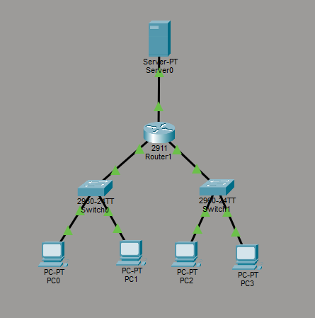
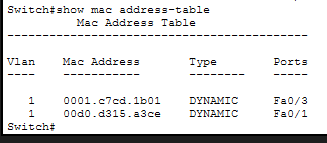
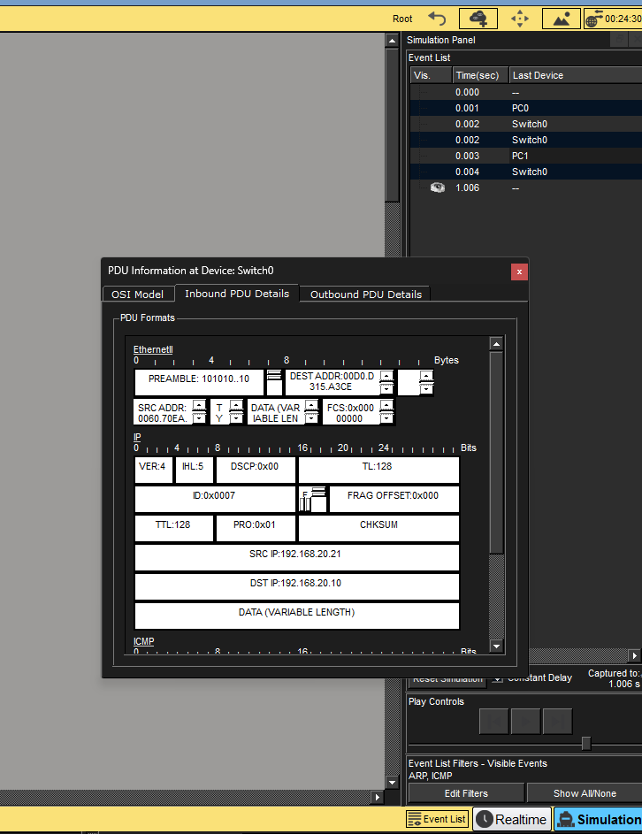
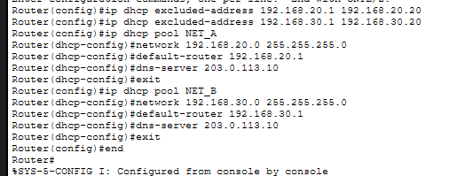
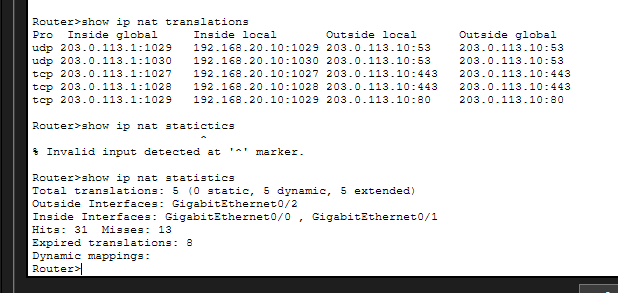
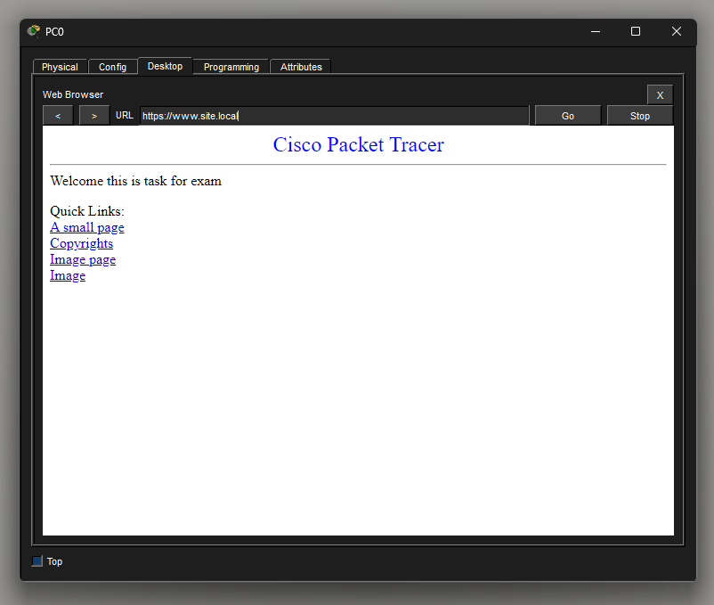

# Отчёт по билету 3. "Коммутатор и ARP-шторм"

**1. Топология и адресация**

В сети использованы четыре ПК, два коммутатора, маршрутизатор и внешний сервер. PC0 и PC1 находятся в сети `192.168.20.0/24`, PC2 и PC3 — в сети `192.168.30.0/24`. На PC0 и PC2 заданы статические IP-адреса, PC1 и PC3 получают адреса по DHCP.

**2. MAC-таблица и flooding**

Коммутатор изучает MAC-адрес отправителя по входящим кадрам и сохраняет соответствие MAC-адреса порту. Если MAC-адрес назначения неизвестен, коммутатор выполняет flooding и отправляет кадр через подходящие порты, кроме входного. Широковещательные кадры, включая ARP-запросы, также распространяются в пределах соответствующего VLAN.

**3. ARP-запрос и ответ**

При обращении к устройству в своей подсети компьютер отправляет ARP Request, чтобы определить MAC-адрес назначения. Устройство с соответствующим IP-адресом отвечает ARP Reply. После этого отправитель может передавать IP-пакеты внутри Ethernet-кадров. Обмен наблюдался в режиме Simulation с помощью PDU Information.

ARP-шторм представляет собой чрезмерный поток ARP-пакетов. Единичный ARP-запрос является нормальным процессом разрешения адреса.

**4. DHCP, NAT/PAT и DNS**

На маршрутизаторе настроены два DHCP-пула с разными сетями и шлюзами. 

Настроен NAT/PAT для внутренних сетей. 

На внешнем сервере включены DNS и HTTP; добавлены A-запись `www.site.local`.

**5. Инкапсуляция при передаче данных**

При отправке данных приложения транспортный уровень формирует TCP-сегмент или UDP-дейтаграмму, сетевой уровень добавляет IP-заголовок, а канальный уровень помещает IP-пакет в Ethernet-кадр. Физический уровень передаёт биты по среде.

Коммутатор пересылает Ethernet-кадры по MAC-адресам. При маршрутизации на другой IP-сегмент маршрутизатор удаляет входной канальный заголовок, анализирует IP-пакет и инкапсулирует его в новый кадр для выходного интерфейса. IP-адреса источника и назначения обычно сохраняются, если не применяется NAT, а MAC-адреса канального кадра меняются на каждом маршрутизируемом переходе.
