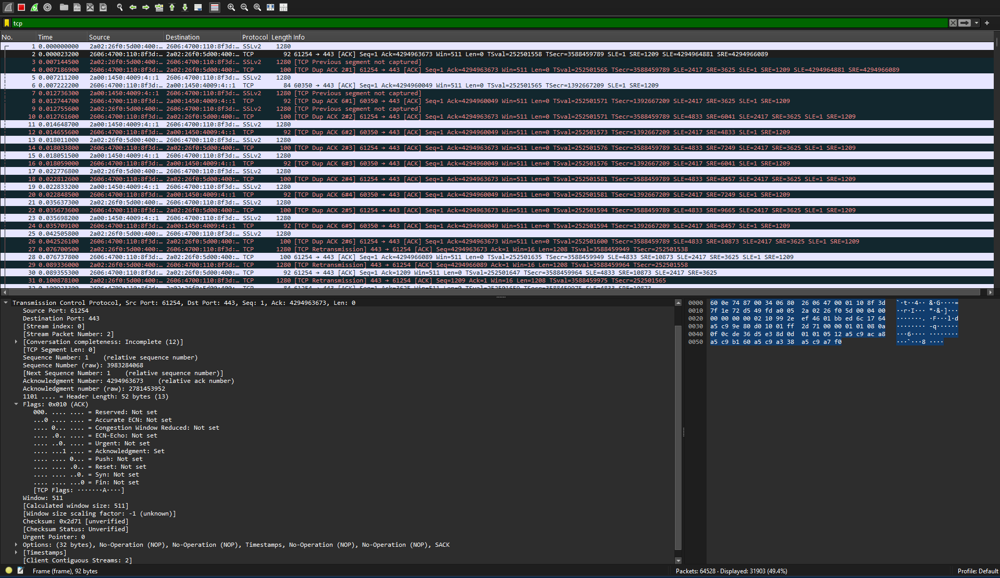
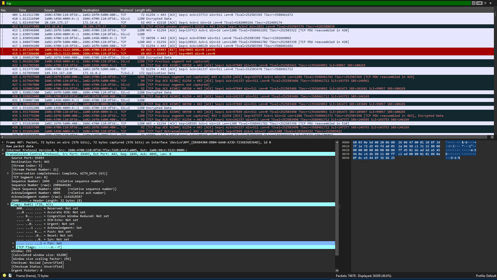
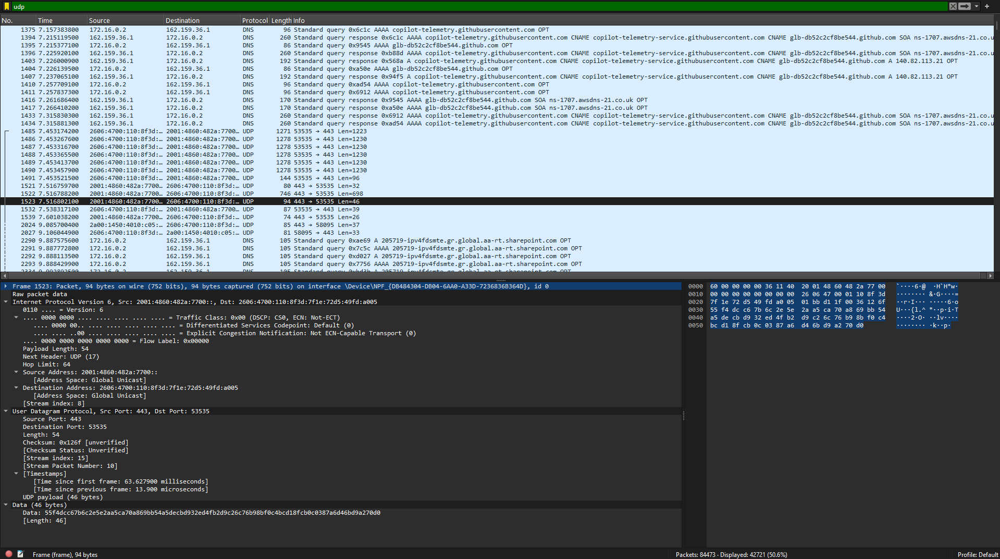

# Задание

>Вам потребуется прислать 3 скриншот из wireshark где на 2-х tcp с разными флагами, а на 3 udp

## Скриншоты TCP и UDP из WireShark

Вот два скриншота с TCP с разными наборами флагов:

Вот скриншот с UDP:

