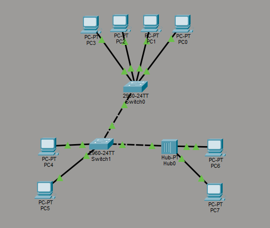
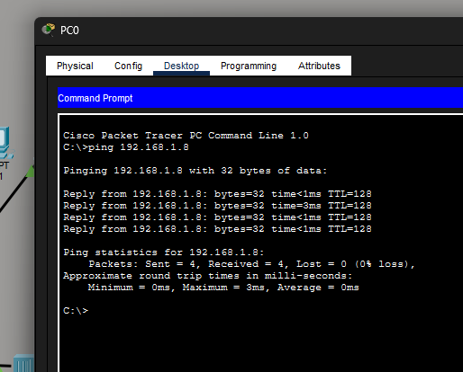
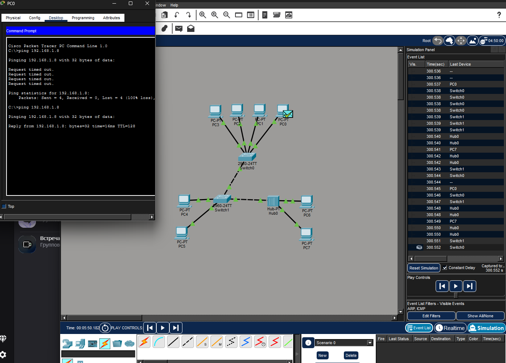

# Задание

>Вам потребуется построить сеть в циско с 8 компьютераи 2 комутаторами и 1 хабом в дз присылаете ссылку на гитхаб где у вас 3 фото на 1 схема на втором консольный ping,  на 3 работа симулятора по отправки пинга

## Схема сети

Схема представлена на рисунке ниже: 

## Консольный ping

Работа команды ping в Realtime (Пинговался PC7 с PC0)

## Работа симуляции ping

Работа команды ping в Simulation (Пинговался PC7 с PC0)

#

Файл с самой программы прикреплен в этой же папке под названием hw_cisco_2.pkt . Можете его просмотреть при необходимости.